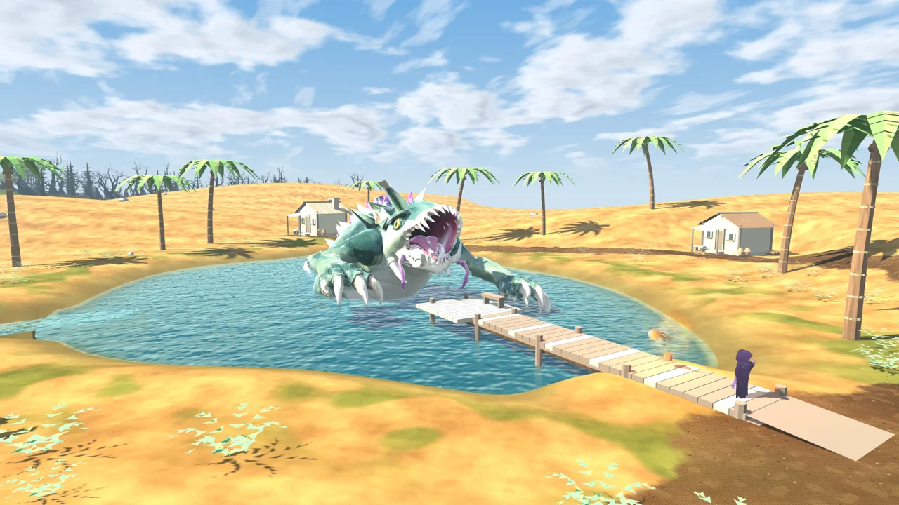

# Relic of the Fallen Star

*Relic of the Fallen Star* est un jeu d’aventure fantastique en 3D à la troisième personne. Incarne Nael et remonte la piste des fragments d’une étoile tombée. Explore la Forêt des lueurs, les cavernes et les abords du lac, rencontre les habitants de la vallée et débloque des pouvoirs au fil des quêtes.

## Jouer

Le jeu est en développement. La version de test permet d’explorer plusieurs zones, de suivre des quêtes, d’essayer le combat et la magie, et de sauvegarder sa progression.

Les versions publiques seront disponibles dans [Releases](https://github.com/AnalogShade/relic-of-the-fallen-star/releases) lorsqu’elles seront publiées. Des exécutables autonomes ont été préparés pour Windows, Linux et macOS. Le démarrage de la version Windows 64 bits a été vérifié. Les exports Linux et macOS restent à tester sur leurs plateformes respectives.

### Commandes principales

| Commande | Action |
| --- | --- |
| WASD / ZQSD | Se déplacer selon la position physique des touches |
| Souris / molette | Orienter la caméra / régler sa distance |
| Espace / Maj | Sauter / courir |
| Clic gauche | Attaquer avec les griffes |
| F | Interagir, ramasser ou cueillir |
| I / J | Ouvrir l’inventaire / le journal de quêtes |
| Échap | Ouvrir le menu pause et accéder aux options ou à la sauvegarde |

Le menu **Options → Commandes / Raccourcis clavier** affiche les autres commandes.

## Ouvrir le projet dans Godot

1. Installe [Godot 4.6.1](https://godotengine.org/download/archive/4.6.1-stable/) et [Git LFS](https://git-lfs.com/).
2. Après avoir cloné le dépôt, lance `git lfs pull` à sa racine pour récupérer les ressources.
3. Dans le gestionnaire de projets Godot, importe [godot/project.godot](godot/project.godot). Ouvre le projet, puis appuie sur **F5** pour lancer le menu principal.

Le [guide du projet Godot](godot/README.md) décrit les scènes, les systèmes principaux et les vérifications locales.

## Signaler un bogue

Si tu as accès au dépôt, utilise les [Issues GitHub](https://github.com/AnalogShade/relic-of-the-fallen-star/issues). Indique la version du jeu, ton système d’exploitation, l’endroit où le problème se produit et les étapes pour le reproduire.

## Licence et crédits

Le jeu est gratuit pour un usage personnel et non commercial. Tu peux le télécharger, y jouer et le modifier pour ton usage privé. Toute exploitation commerciale des éléments protégés du jeu exige une autorisation écrite préalable. Les conditions complètes figurent dans la [licence bilingue](LICENSE).

Les composants sous licence distincte conservent leurs propres conditions, notamment [Godot](https://godotengine.org/license/), l’extension [Godot MCP (MIT)](godot/addons/godot_mcp/LICENSE) et les polices [Cinzel](godot/assets/ui/title/OFL-Cinzel.txt) et [Cinzel Decorative](godot/assets/ui/title/OFL-CinzelDecorative.txt) (SIL Open Font License).

Pour une autorisation ou un partenariat, communique avec l’équipe du jeu sur [luiconumérique.ca](https://luiconumérique.ca).
